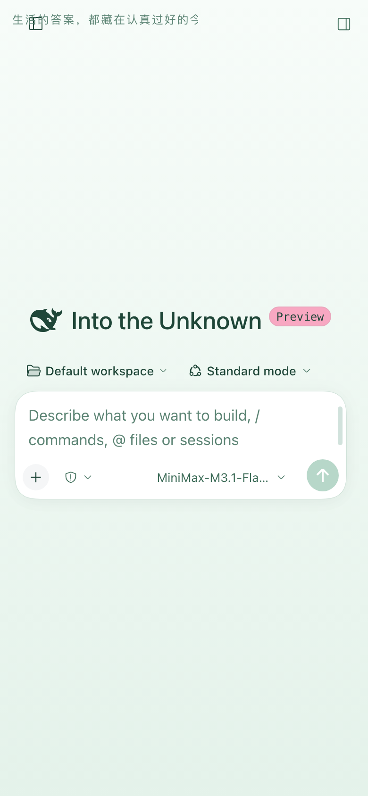
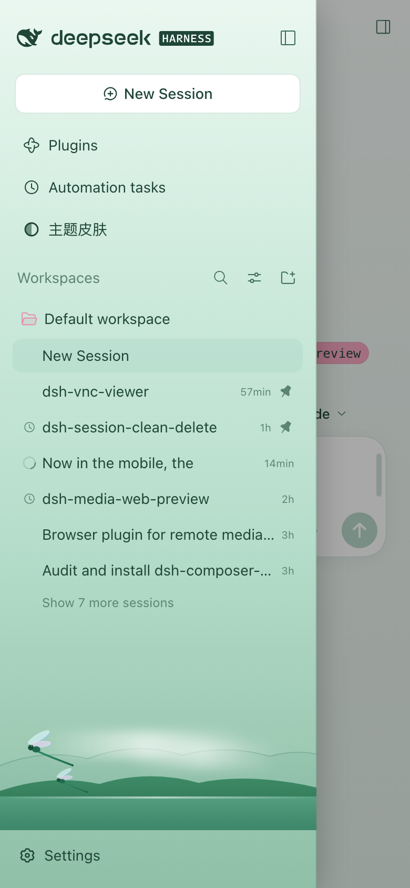
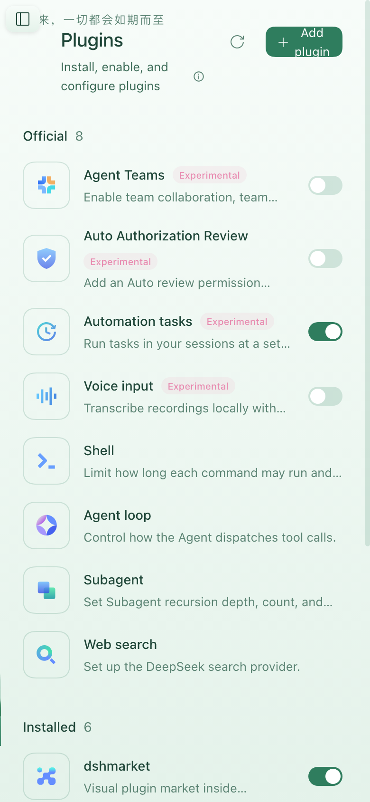
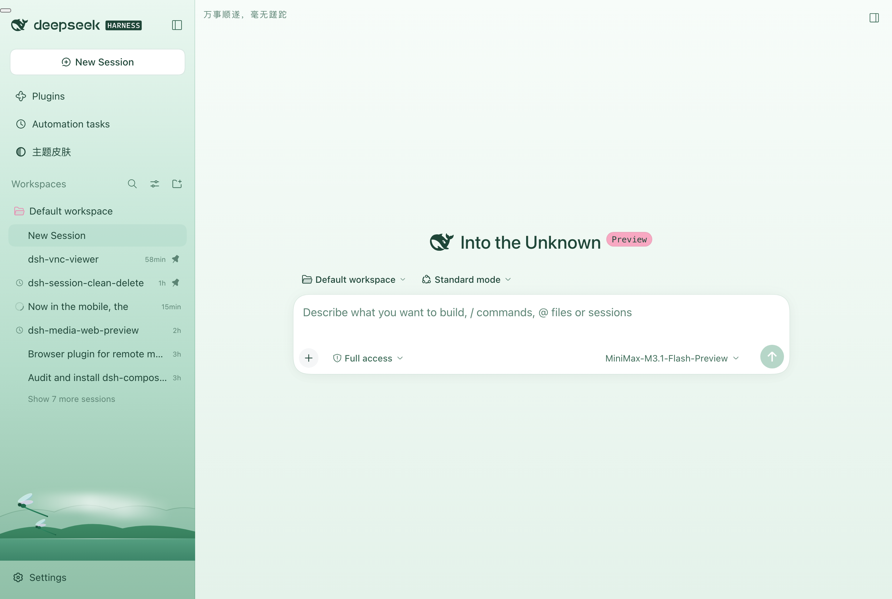

# dsh-mobile-sidebar

Give the whole left column back to the conversation on phones.

## What it changes

Below **1024px** — the same breakpoint at which `@deepseek-ai/dsh-client-ui-layout`
auto-collapses the sidebar — the stock web shell still keeps a **56px icon rail**
(`computeColumns()` resolves the collapsed track to `collapsedWidth`, which is 56 on
the web; only macOS desktop and the Windows titlebar shell pass 0). On a 390px
viewport that rail eats 14% of the screen for a column you cannot read anything in.

This plugin, under the same breakpoint:

| | stock | with the plugin |
|---|---|---|
| frame tracks at 390px | `56px 334px 0px` | `0px 390px 0px` |
| collapsed sidebar | 56px icon rail | nothing — no track, no paint |
| opening the sidebar | squeezes the centre to 110px | 300px drawer over a 390px centre, tap outside to close |
| header | no toggle | panel-left button at the header's leading edge |
| ≥ 1024px | — | untouched (`280px 1000px 0px`, button hidden) |

## Install

```bash
dsh plugin --profile web add file:/path/to/dsh-mobile-sidebar
```

`dsh plugin add` appends the package to `dsh.profile.bundles` and hot-mounts it;
the browser only needs a **refresh** to load the new client combo. No `dsh web`
restart is required.

To remove it, delete the `"dsh-mobile-sidebar"` entry from `bundles` in
`~/.dsh/profiles/<profile>/package.json`, or disable the bundle from the Plugins
page.

## How it works

Everything is browser-side; the Host half is intentionally empty.

1. **Zero the sidebar track.** React writes `grid-template-columns` as an inline
   style, and a media query cannot override one track of it. A `MutationObserver`
   on the frame watches every solve, rewrites the value with **only the first
   track** replaced, and republishes it through the
   `--dsh-mobile-frame-cols` custom property. The centre and right tracks still
   matter between 800px and 1024px, where the right panel solves a real third
   track, so they are carried through untouched.
2. **Hide the rail without leaving the grid.** `visibility: hidden`, *not*
   `display: none`. A `display:none` box is not a grid item, so auto-placement
   slides the centre column into the now-0px first track and the conversation
   renders at zero width.
3. **Open as a drawer.** The column stays a grid item in its 0px track and simply
   overflows it (`position: relative` + an explicit width), so the centre column
   never changes width. A scrim in the `shell.overlay` slot closes it on tap.
4. **The toggle.** On the Conversation it is a primitives `Button` +
   `IconPanelLeftOutlineRegular` in the `conversation.header.leading` slot, calling
   `ctx.layout.toggleSidebar()`.

## Global panels (Plugins, Automation tasks, …)

The Conversation is the **only** panel that declares a header slot. Every other
global panel registers into the keyed `main` slot and builds its own heading —
Plugins renders `<header class="…pageHead">`, Schedules renders
`<div class="…pageHeading">`, and neither exposes anything to inject into.

So the toggle falls back to a fixed control rendered in `shell.overlay`, which
the shell always mounts at root scope. That covers every panel at once, including
panels that do not exist yet. Two rules keep it honest:

- **It steps aside on the Conversation.** `[frame]:not(:has([data-dsh-mobile-sidebar-button]))`
  is what hides it there, so the in-header button and the floating one never
  appear together.
- **It reserves its own lane.** Panel headings all start 28px down and 24px in,
  so the control would sit on the title's shoulder; a rule adds 40px of
  `padding-inline-start` to those headings while the control is present.

| where | control |
|---|---|
| Conversation | `conversation.header.leading` slot |
| Plugins / Schedules / any future panel | fixed control in `shell.overlay` |
| ≥ 1024px | neither |

## Screenshots

Closed on a phone — the rail is gone and the conversation keeps the full width:



Tapping the header toggle opens the drawer over that same full-width conversation:



On a global panel the toggle falls back to a fixed control:



Above the breakpoint nothing changes:



## Upgrades

The plugin targets source-written attributes, not the shell's CSS-module class
names (which are build-hashed and change between DSH releases):

- `[data-shell-overlay]` — the frame is its parent element
- `[data-slot="sidebar"]` — the sidebar column is its parent element
- `[data-sidebar-collapsed]` on the frame — closed vs. open
- `[data-plugin-panel]` — the one global panel that marks its section; the rest
  are matched on the `_pageHead` / `_pageHeading` class fragment

## License

MIT
